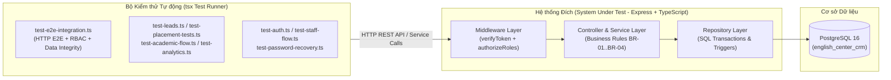
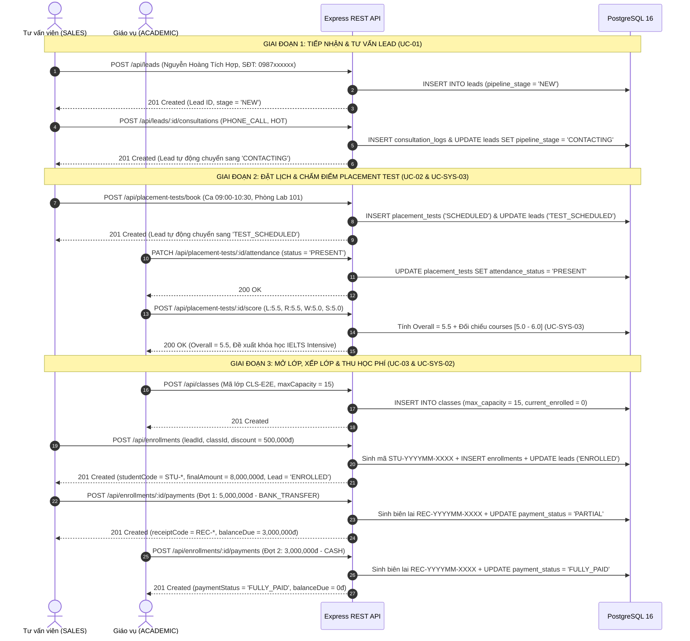

# TÀI LIỆU KỊCH BẢN KIỂM THỬ TÍCH HỢP (INTEGRATION TESTING) & BÁO CÁO KẾT QUẢ THỰC THI / THEO DÕI LỖI (TEST EXECUTION & BUG TRACKING REPORT)

**Dự án:** Hệ thống Quản lý Tuyển sinh và Đào tạo Trung tâm Ngoại ngữ (English Center CRM - EduFlow CRM)  
**Mã tài liệu:** `TEST-01` | **Mã công việc WBS:** `1.4.1`  
**Phiên bản:** `1.0 (Final Release Verification)`  
**Ngày ban hành:** `24/10/2026`  
**Người lập:** `Long Phạm (@longphm11)` — QA Lead / Backend & Frontend Developer  
**Người phê duyệt:** `Trần Minh Tâm` — Project Manager (Nhóm 8 - PTIT)

---

## MỤC LỤC
1. [Chiến lược & Phương pháp Kiểm thử (Test Strategy & Methodology)](#1-chiến-lược--phương-pháp-kiểm-thử-test-strategy--methodology)
2. [Bảng Kịch bản Kiểm thử Chi tiết (Detailed Test Cases: UC-01, UC-02, UC-03, UC-04, UC-05)](#2-bảng-kịch-bản-kiểm-thử-chi-tiết-detailed-test-cases-uc-01-uc-02-uc-03-uc-04-uc-05)
3. [Kiểm thử Luồng Nghiệp vụ Khép kín End-to-End (Closed-Loop E2E Flow)](#3-kiểm-thử-luồng-nghiệp-vụ-khép-kín-end-to-end-closed-loop-e2e-flow)
4. [Kiểm thử Bảo mật Phân quyền RBAC (Role-Based Access Control Verification)](#4-kiểm-thử-bảo-mật-phân-quyền-rbac-role-based-access-control-verification)
5. [Kiểm thử Ràng buộc Toàn vẹn Dữ liệu & Quy tắc Nghiệp vụ (Data Integrity Testing)](#5-kiểm-thử-ràng-buộc-toàn-vẹn-dữ-liệu--quy-tắc-nghiệp-vụ-data-integrity-testing)
6. [Báo cáo Tổng hợp Kết quả Thực thi (Test Execution Report) & Danh sách Theo dõi Lỗi (Bug Tracking Log)](#6-báo-cáo-tổng-hợp-kết-quả-thực-thi-test-execution-report--danh-sách-theo-dõi-lỗi-bug-tracking-log)

---

## 1. CHIẾN LƯỢC & PHƯƠNG PHÁP KIỂM THỬ (TEST STRATEGY & METHODOLOGY)

### 1.1. Mục tiêu Kiểm thử
Tài liệu `TEST-01` thiết lập bộ quy chuẩn kiểm thử tích hợp toàn diện cho hệ thống **English Center CRM (EduFlow CRM)** trước khi bàn giao релиз chính thức (Production Release), nhằm đảm bảo:
1. **Tính đúng đắn của luồng nghiệp vụ khép kín (End-to-End Business Continuity):** Xác minh sự liên thông dữ liệu xuyên suốt từ khâu **Tiếp nhận Lead (UC-01)** $\rightarrow$ **Đặt lịch & Chấm điểm Thi xếp lớp (UC-02 / UC-SYS-03)** $\rightarrow$ **Mở lớp, Xếp lớp & Khóa sĩ số tự động (UC-03 / UC-SYS-02)** $\rightarrow$ **Thu học phí, Cấp biên lai & Đồng bộ Dashboard Doanh thu (UC-04)**.
2. **Tuân thủ nghiêm ngặt Ma trận Phân quyền RBAC (Security & Access Control):** Đảm bảo cơ chế xác thực `JWT Bearer Token` và middleware `authorizeRoles` chặn triệt để các hành vi truy cập vượt quyền (`HTTP 403 Forbidden`), bao gồm việc **Tư vấn viên (`SALES`) không xem được báo cáo doanh thu tài chính** và **Giáo vụ (`ACADEMIC`) không xóa được lớp học / khóa học**.
3. **Đảm bảo Toàn vẹn Dữ liệu (ACID & Business Rule Integrity):** Kiểm chứng các ràng buộc CSDL PostgreSQL và tầng Service (`BR-01` chống trùng số điện thoại Lead, `BR-02` bắt buộc nhập lý do khi chuyển `LOST`, `BR-03` chống trùng lịch thi đầu vào, `BR-04` khóa tự động khi lớp đạt trần **15 học viên/lớp**).

### 1.2. Kiến trúc & Môi trường Kiểm thử (Test Environment)

| Thành phần Môi trường | Thông số Kỹ thuật / Phiên bản | Vai trò trong Kiểm thử |
| :--- | :--- | :--- |
| **Hệ điều hành & Runtime** | Windows 11 / Node.js `v22.x` + `tsx v4.19.2` | Thực thi trực tiếp các kịch bản kiểm thử TypeScript |
| **Backend API Server** | Express `v4.21.2`, TypeScript `v5.7.2`, Helmet, CORS | Tiếp nhận HTTP Request, kiểm tra JWT & RBAC |
| **Cơ sở dữ liệu (DBMS)** | PostgreSQL `16` (Database: `english_center_crm`) | Kiểm chứng ràng buộc khóa ngoại, Unique Index, ACID Transaction |
| **Frontend Application** | React `19.2.4`, TypeScript `5.9.3`, Vite `8.0.1`, TailwindCSS `4.2` | Kiểm thử giao diện đa vai trò, Kanban Drag-and-Drop, Biểu đồ SVG |
| **Tài khoản Kiểm thử chuẩn** | `tamminh` (`ADMIN`), `longpham` (`SALES`), `phongpham` (`ACADEMIC`) | Kiểm thử phân quyền chéo (Cross-Role Security Verification) |

### 1.3. Danh mục Kịch bản Kiểm thử Tự động (Automated Test Scripts)

Dự án đã xây dựng **08 bộ script kiểm thử tự động** đặt tại thư mục [`backend/src/scripts/`](file:///C:/Users/A.Long/OneDrive/Desktop/QLDAPM/English-center-CRM/backend/src/scripts), có thể kích hoạt bất kỳ lúc nào qua `npm run`:

| Lệnh Thực thi (`npm run`) | File Script Kiểm thử | Phạm vi Kiểm thử (Test Scope) | Số lượng Assertion |
| :--- | :--- | :--- | :---: |
| `npm run test:e2e` | [`test-e2e-integration.ts`](file:///C:/Users/A.Long/OneDrive/Desktop/QLDAPM/English-center-CRM/backend/src/scripts/test-e2e-integration.ts) | **Kiểm thử Tích hợp E2E khép kín, Bảo mật RBAC & Ràng buộc Dữ liệu (`TEST-01`)** | **21** |
| `npm run test:leads` | [`test-leads.ts`](file:///C:/Users/A.Long/OneDrive/Desktop/QLDAPM/English-center-CRM/backend/src/scripts/test-leads.ts) | Quản lý & Tiếp nhận Lead, Kanban 5 cột, Timeline Tư vấn (`UC-01 / BE-03`) | **14** |
| `npm run test:tests` | [`test-placement-tests.ts`](file:///C:/Users/A.Long/OneDrive/Desktop/QLDAPM/English-center-CRM/backend/src/scripts/test-placement-tests.ts) | Đặt lịch thi, Điểm danh, Chấm điểm 4 kỹ năng & Gợi ý khóa học (`UC-02 / BE-04`) | **8** |
| `npm run test:academic` | [`test-academic-flow.ts`](file:///C:/Users/A.Long/OneDrive/Desktop/QLDAPM/English-center-CRM/backend/src/scripts/test-academic-flow.ts) | CRUD Khóa học, Lớp học, Xếp lớp sinh mã `STU-xxx`, Thu phí `REC-xxx` (`UC-03 / BE-05`) | **14** |
| `npm run test:analytics` | [`test-analytics.ts`](file:///C:/Users/A.Long/OneDrive/Desktop/QLDAPM/English-center-CRM/backend/src/scripts/test-analytics.ts) | Dashboard Thống kê KPI, Phễu chuyển đổi, Doanh thu, Leaderboard (`UC-04 / BE-06`) | **8** |
| `npm run test:auth` | [`test-auth.ts`](file:///C:/Users/A.Long/OneDrive/Desktop/QLDAPM/English-center-CRM/backend/src/scripts/test-auth.ts) | Xác thực JWT, Đăng nhập, Đổi mật khẩu, RBAC Middleware (`UC-05 / BE-02`) | **7** |
| `npm run test:password` | [`test-password-recovery.ts`](file:///C:/Users/A.Long/OneDrive/Desktop/QLDAPM/English-center-CRM/backend/src/scripts/test-password-recovery.ts) | Luồng Quên mật khẩu & Đặt lại mật khẩu qua OTP (`UC-05 / BE-02`) | **5** |
| `npm run test:staff` | [`test-staff-flow.ts`](file:///C:/Users/A.Long/OneDrive/Desktop/QLDAPM/English-center-CRM/backend/src/scripts/test-staff-flow.ts) | Quản lý Hồ sơ Nhân sự, Phân quyền & Khóa tài khoản (`UC-05 / BE-07`) | **11** |

---

## 2. BẢNG KỊCH BẢN KIỂM THỬ CHI TIẾT (DETAILED TEST CASES: UC-01, UC-02, UC-03, UC-04, UC-05)

### 2.1. Phân hệ Quản lý & Chăm sóc Khách hàng Tiềm năng (`UC-01` — Lead & Pipeline Management)

| Mã TC | Tên Kịch bản Kiểm thử | Điều kiện Tiên quyết (Pre-conditions) | Dữ liệu Đầu vào (Input Data) | Kết quả Kỳ vọng (Expected Result) | Kết quả Thực tế (Actual Result) | Trạng thái |
| :--- | :--- | :--- | :--- | :--- | :--- | :---: |
| **TC-UC01-01** | Tiếp nhận Lead mới hợp lệ vào phễu tuyển sinh | Đăng nhập vai trò `SALES` (`longpham`) | `fullName: "Nguyễn Hoàng Tích Hợp"`, `phoneNumber: "0987xxxxxx"`, `interest: "IELTS"`, `sourceChannel: "FB_ADS"` | `HTTP 201 Created`; Bản ghi lưu vào bảng `leads` với `pipelineStage = "NEW"`, tự động gán `assignedSalesId = user.id` | `HTTP 201 Created`; Tạo Lead thành công với `pipelineStage = "NEW"`, gán người phụ trách `longpham` | **PASS** |
| **TC-UC01-02** | Kiểm tra ràng buộc chống trùng số điện thoại Lead (`BR-01`) | Số điện thoại `0987xxxxxx` đã tồn tại trong bảng `leads` | Gửi `POST /api/leads` với `phoneNumber: "0987xxxxxx"`, `fullName: "Khách Hàng Trùng Số"` | `HTTP 409 Conflict`; Hệ thống từ chối tạo bản ghi trùng và trả về thông báo lỗi `BR-01` kèm thông tin Lead cũ | `HTTP 409 Conflict`: *"Số điện thoại 0987xxxxxx đã tồn tại trong hệ thống"* | **PASS** |
| **TC-UC01-03** | Kiểm tra định dạng số điện thoại không hợp lệ | Đăng nhập vai trò `SALES` | `phoneNumber: "012345"` (6 chữ số, sai chuẩn VN 10–11 số) | `HTTP 400 Bad Request`; Từ chối dữ liệu đầu vào tại tầng Validation | `HTTP 400 Bad Request`: *"Số điện thoại không hợp lệ (cần 10-11 chữ số bắt đầu bằng 0)"* | **PASS** |
| **TC-UC01-04** | Truy vấn danh sách Lead có tìm kiếm và phân trang | Có ít nhất 10 bản ghi Lead trong CSDL | `GET /api/leads?search=Kiểm Thử&page=1&limit=10` | `HTTP 200 OK`; Trả về mảng `leads`, tổng số `total`, `page`, `totalPages` khớp từ khóa | `HTTP 200 OK`; Trả về danh sách Lead khớp từ khóa tìm kiếm chính xác | **PASS** |
| **TC-UC01-05** | Hiển thị cấu trúc Bảng Kanban Pipeline 5 cột | Đăng nhập `SALES` / `ADMIN` | `GET /api/leads/kanban` | `HTTP 200 OK`; Trả về 5 cột (`NEW`, `CONTACTING`, `TEST_SCHEDULED`, `ENROLLED`, `LOST`) kèm `counts` | `HTTP 200 OK`; Đủ 5 cột dữ liệu và bộ đếm `counts` chính xác tuyệt đối | **PASS** |
| **TC-UC01-06** | Ghi nhật ký cuộc gọi tư vấn & Tự động chuyển trạng thái `NEW` $\rightarrow$ `CONTACTING` | Lead đang ở trạng thái `pipelineStage = "NEW"` | `POST /api/leads/:id/consultations` với `interactionType: "PHONE_CALL"`, `potentialLevel: "HOT"`, `content: "Đã tư vấn lộ trình..."` | `HTTP 201 Created`; Lưu bản ghi vào `consultation_logs` và tự động cập nhật Lead sang `CONTACTING` | `HTTP 201 Created`; Nhật ký được ghi nhận, `lead.pipelineStage` tự động chuyển thành `"CONTACTING"` | **PASS** |
| **TC-UC01-07** | Kéo thả thẻ Kanban cập nhật trạng thái hợp lệ | Lead đang ở trạng thái `CONTACTING` | `PATCH /api/leads/:id/status` với `{ "pipelineStage": "TEST_SCHEDULED" }` | `HTTP 200 OK`; Cập nhật cột `pipeline_stage = "TEST_SCHEDULED"` và ghi log hệ thống | `HTTP 200 OK`; Trạng thái cập nhật tức thì sang `"TEST_SCHEDULED"` | **PASS** |
| **TC-UC01-08** | Chặn chuyển trạng thái Lead sang `LOST` khi bỏ trống lý do hủy (`BR-02`) | Lead đang hoạt động trong phễu | `PATCH /api/leads/:id/status` với `{ "pipelineStage": "LOST", "lostReason": "" }` | `HTTP 400 Bad Request`; Bắt buộc nhập `lostReason` khi đánh dấu khách hàng từ chối | `HTTP 400 Bad Request`: *"Vui lòng nhập lý do khách hàng từ chối/hủy (lostReason) khi chuyển sang trạng thái Đã hủy (LOST)"* | **PASS** |
| **TC-UC01-09** | Chuyển trạng thái sang `LOST` kèm lý do hợp lệ | Lead đang hoạt động trong phễu | `PATCH /api/leads/:id/status` với `{ "pipelineStage": "LOST", "lostReason": "Lịch học không phù hợp giờ làm việc" }` | `HTTP 200 OK`; Lưu `pipelineStage = "LOST"` và `lostReason` đầy đủ | `HTTP 200 OK`; Lưu thành công trạng thái `LOST` và lý do hủy | **PASS** |
| **TC-UC01-10** | Điều chuyển / Phân công lại Tư vấn viên phụ trách Lead | Đăng nhập `ADMIN` hoặc `SALES` | `PATCH /api/leads/:id/assign` với `{ "assignedSalesId": 1 }` | `HTTP 200 OK`; Cập nhật `assigned_sales_id` và tự động ghi sự kiện điều chuyển vào Timeline | `HTTP 200 OK`; Cập nhật người phụ trách mới và lưu lịch sử trên Timeline | **PASS** |

---

### 2.2. Phân hệ Tổ chức Thi Xếp lớp & Thuật toán Gợi ý Khóa học (`UC-02` & `UC-SYS-03` — Placement Test & Course Recommendation)

| Mã TC | Tên Kịch bản Kiểm thử | Điều kiện Tiên quyết (Pre-conditions) | Dữ liệu Đầu vào (Input Data) | Kết quả Kỳ vọng (Expected Result) | Kết quả Thực tế (Actual Result) | Trạng thái |
| :--- | :--- | :--- | :--- | :--- | :--- | :---: |
| **TC-UC02-01** | Đặt lịch thi xếp lớp Placement Test & Đồng bộ trạng thái Lead | Lead đang ở trạng thái `NEW` hoặc `CONTACTING` | `POST /api/placement-tests/book` với `{ leadId, testDate: "2026-10-27", timeSlot: "09:00 - 10:30", room: "Phòng Lab 101", testType: "IELTS" }` | `HTTP 201 Created`; Tạo lịch thi `attendanceStatus = "SCHEDULED"`, đồng bộ `lead.pipelineStage = "TEST_SCHEDULED"` | `HTTP 201 Created`; Tạo ca thi thành công, Lead tự động chuyển sang `"TEST_SCHEDULED"` | **PASS** |
| **TC-UC02-02** | Chặn đặt trùng lịch thi khi thí sinh đang có lịch `SCHEDULED` (`BR-03`) | Thí sinh đã có 1 lịch thi ở trạng thái `SCHEDULED` chưa hoàn tất | Gửi tiếp `POST /api/placement-tests/book` cho cùng `leadId` | `HTTP 409 Conflict`; Chặn tạo lịch thi trùng lặp cho cùng một thí sinh | `HTTP 409 Conflict`: *"Học viên này đã có một lịch thi đang chờ (SCHEDULED)"* | **PASS** |
| **TC-UC02-03** | Kiểm tra sức chứa phòng thi theo ca thi (`GET /api/placement-tests/availability`) | Có ca thi đã đặt trong khoảng thời gian truy vấn | `GET /api/placement-tests/availability?startDate=2026-10-27&endDate=2026-10-27` | `HTTP 200 OK`; Trả về danh sách ca thi kèm `totalBooked`, `maxCapacity` (15), `isFull` | `HTTP 200 OK`; Trả về chính xác số lượng thí sinh đã đặt trên từng ca/phòng | **PASS** |
| **TC-UC02-04** | Điểm danh thí sinh một chạm (`PRESENT` / `ABSENT`) | Ca thi đang ở trạng thái `SCHEDULED`; Đăng nhập `ACADEMIC` | `PATCH /api/placement-tests/:id/attendance` với `{ "attendanceStatus": "PRESENT", "notes": "Đến đúng giờ" }` | `HTTP 200 OK`; Cập nhật `attendance_status = "PRESENT"` | `HTTP 200 OK`; Cập nhật trạng thái điểm danh `"PRESENT"` thành công | **PASS** |
| **TC-UC02-05** | Nhập điểm 4 kỹ năng & Tự động làm tròn điểm Overall chuẩn IELTS | Thí sinh đã được điểm danh `PRESENT`; Đăng nhập `ACADEMIC` | `POST /api/placement-tests/:id/score` với `listening: 5.5, reading: 5.5, writing: 5.0, speaking: 5.0` (TB = `5.25`) | `HTTP 200 OK`; Tự động tính và làm tròn chuẩn IELTS `overallScore = 5.5` | `HTTP 200 OK`; Điểm `overallScore` được tính tự động bằng `5.5` | **PASS** |
| **TC-UC02-06** | Kiểm tra biên độ điểm đầu vào ngoài phạm vi hợp lệ (`0.0 - 9.0` cho IELTS) | Đăng nhập `ACADEMIC` | Nhập `listeningScore: 10.5` hoặc `-1.0` cho bài thi `IELTS` | `HTTP 400 Bad Request`; Từ chối điểm số vượt ngưỡng thang điểm IELTS `[0.0 - 9.0]` | `HTTP 400 Bad Request`; Chặn điểm số không hợp lệ | **PASS** |
| **TC-UC02-07** | Thuật toán tự động đề xuất khóa học (`UC-SYS-03`) khi chấm điểm | Khóa `IELTS-55` có chuẩn đầu vào `[5.0 - 6.0]`; Học viên đạt `Overall = 5.5` | Chấm điểm `overallScore = 5.5` qua `POST /api/placement-tests/:id/score` | Hệ thống tự động đối chiếu bảng `courses`, gắn `recommended_course_id` và trả về danh sách lớp mở còn chỗ trống | Gợi ý chính xác khóa học có `[minEntryScore <= 5.5 <= maxEntryScore]` kèm danh sách `availableClasses` | **PASS** |
| **TC-UC02-08** | Tra cứu độc lập thuật toán gợi ý khóa học theo mức điểm bất kỳ | Đăng nhập `SALES` hoặc `ACADEMIC` | `GET /api/placement-tests/recommend-course?score=6.5&testType=IELTS` | `HTTP 200 OK`; Trả về khóa học nâng cao phù hợp với mức điểm `6.5` kèm lý do `matchReason` | `HTTP 200 OK`; Đề xuất khóa học và danh sách lớp học mở tương ứng | **PASS** |

---

### 2.3. Phân hệ Quản lý Đào tạo, Mở lớp, Xếp lớp & Thu Học phí (`UC-03` & `UC-SYS-02` — Academic, Enrollment & Payment)

| Mã TC | Tên Kịch bản Kiểm thử | Điều kiện Tiên quyết (Pre-conditions) | Dữ liệu Đầu vào (Input Data) | Kết quả Kỳ vọng (Expected Result) | Kết quả Thực tế (Actual Result) | Trạng thái |
| :--- | :--- | :--- | :--- | :--- | :--- | :---: |
| **TC-UC03-01** | Tạo mới Khóa học trong danh mục đào tạo | Đăng nhập `ACADEMIC` hoặc `ADMIN` | `POST /api/courses` với `{ courseCode: "IELTS-E2E", courseName: "IELTS Intensive", totalLessons: 36, standardTuition: 8500000, minEntryScore: 5.0, maxEntryScore: 6.0 }` | `HTTP 201 Created`; Tạo khóa học mới trong bảng `courses` | `HTTP 201 Created`; Khóa học được lưu thành công với học phí `8,500,000 VND` | **PASS** |
| **TC-UC03-02** | Mở Lớp học mới với trần sĩ số chuẩn `maxCapacity = 15` | Khóa học `courseId` đã tồn tại; Đăng nhập `ACADEMIC` | `POST /api/classes` với `{ courseId, classCode: "CLS-E2E", scheduleDays: "MON_WED_FRI", timeSlot: "18:00 - 19:30", room: "Phòng 302", maxCapacity: 15 }` | `HTTP 201 Created`; Khởi tạo lớp học với `currentEnrolled = 0`, `maxCapacity = 15`, `status = "UPCOMING"` | `HTTP 201 Created`; Lớp học được mở thành công, `availableSeats = 15` | **PASS** |
| **TC-UC03-03** | Xếp lớp cho Lead: Tự động sinh mã Học viên `STU-YYYYMM-XXXX` & Chuyển Lead sang `ENROLLED` | Lead đã hoàn tất tư vấn/thi thử; Lớp học còn chỗ trống (`currentEnrolled < 15`) | `POST /api/enrollments` với `{ leadId, classId, discountAmount: 500000 }` | `HTTP 201 Created`; Sinh mã `STU-YYYYMM-XXXX`, tính `finalAmount = 8,000,000`, tăng `currentEnrolled` lên `1`, chuyển `lead.pipelineStage = "ENROLLED"` | `HTTP 201 Created`; Sinh mã học viên `STU-202610-xxxx`, `finalAmount = 8,000,000`, Lead tự động chuyển sang `"ENROLLED"` | **PASS** |
| **TC-UC03-04** | Chặn xếp trùng một học viên vào cùng một lớp học 2 lần | Học viên đã có hồ sơ `ENROLLED` trong lớp `classId` | Gửi lại `POST /api/enrollments` với cùng `leadId`/`studentId` và `classId` | `HTTP 409 Conflict`; Chặn ghi danh trùng lặp trong cùng một lớp | `HTTP 409 Conflict`: *"Học viên đã được xếp vào lớp này rồi"* | **PASS** |
| **TC-UC03-05** | Tự động khóa lớp và chặn ghi danh khi vượt quá 15 học viên/lớp (`BR-04 / UC-SYS-02`) | Lớp học đã đạt sĩ số tối đa `15/15` học viên (`isFull = true`) | Thực hiện xếp học viên thứ 16 vào lớp qua `POST /api/enrollments` | `HTTP 409 Conflict`; Hệ thống tự động khóa lớp (`isFull = true, availableSeats = 0`) và từ chối ghi danh học viên thứ 16 | `HTTP 409 Conflict`: *"Lớp học đã đạt sĩ số tối đa (15/15) và đã bị khóa tự động (UC-SYS-02)"* | **PASS** |
| **TC-UC03-06** | Thu học phí từng phần (Đợt 1) & Cấp biên lai `REC-YYYYMM-XXXX` | Hồ sơ ghi danh có `finalAmount = 8,000,000`, `paymentStatus = "UNPAID"` | `POST /api/enrollments/:id/payments` với `{ amount: 5000000, paymentMethod: "BANK_TRANSFER", transactionReference: "VCB-E2E" }` | `HTTP 201 Created`; Sinh biên lai `REC-YYYYMM-XXXX`, cập nhật `paidAmount = 5,000,000`, `balanceDue = 3,000,000`, `paymentStatus = "PARTIAL"` | `HTTP 201 Created`; Cấp biên lai `REC-202610-xxxx`, `paymentStatus = "PARTIAL"`, dư nợ `3,000,000 VND` | **PASS** |
| **TC-UC03-07** | Thu hoàn tất học phí (Đợt 2) & Chuyển trạng thái `FULLY_PAID` | Hồ sơ ghi danh đang có `balanceDue = 3,000,000`, `paymentStatus = "PARTIAL"` | `POST /api/enrollments/:id/payments` với `{ amount: 3000000, paymentMethod: "CASH" }` | `HTTP 201 Created`; Sinh biên lai thứ 2, cập nhật `paidAmount = 8,000,000`, `balanceDue = 0`, `paymentStatus = "FULLY_PAID"` | `HTTP 201 Created`; Cập nhật `paymentStatus = "FULLY_PAID"`, `balanceDue = 0 VND` | **PASS** |
| **TC-UC03-08** | Chặn thu thêm học phí khi hồ sơ đã hoàn thành 100% (`FULLY_PAID`) | Hồ sơ ghi danh có `paymentStatus = "FULLY_PAID"`, `balanceDue = 0` | Gửi tiếp `POST /api/enrollments/:id/payments` với `{ amount: 1000000, paymentMethod: "CASH" }` | `HTTP 400 Bad Request`; Từ chối thu tiền vượt quá nghĩa vụ học phí | `HTTP 400 Bad Request`: *"Hồ sơ ghi danh này đã hoàn thành 100% học phí, không còn số dư phải đóng"* | **PASS** |
| **TC-UC03-09** | Chuyển lớp học cho học viên (`POST /api/enrollments/:id/transfer`) | Học viên đang ở Lớp A (`2/2` chỗ), Lớp B còn trống (`0/15` chỗ) | `POST /api/enrollments/:id/transfer` với `{ newClassId: classB.id, reason: "Bận lịch tối thứ 4" }` | `HTTP 200 OK`; Chuyển học viên sang Lớp B, tăng sĩ số Lớp B, đồng thời giảm sĩ số Lớp A (`1/2`) và mở khóa Lớp A (`isFull = false`) | `HTTP 200 OK`; Chuyển lớp thành công và giải phóng chỗ trống ở lớp cũ chính xác | **PASS** |

---

### 2.4. Phân hệ Báo cáo Điều hành & Quản trị Hệ thống (`UC-04` & `UC-05` — Analytics, Auth & Staff Management)

| Mã TC | Tên Kịch bản Kiểm thử | Điều kiện Tiên quyết (Pre-conditions) | Dữ liệu Đầu vào (Input Data) | Kết quả Kỳ vọng (Expected Result) | Kết quả Thực tế (Actual Result) | Trạng thái |
| :--- | :--- | :--- | :--- | :--- | :--- | :---: |
| **TC-UC04-01** | Truy vấn Tổng quan KPI Điều hành (`GET /api/analytics/overview`) | Đăng nhập `ADMIN` | `GET /api/analytics/overview` | `HTTP 200 OK`; Trả về tổng Lead, tỷ lệ chuyển đổi, tổng doanh thu thực thu, công nợ, tỷ lệ lấp đầy lớp | `HTTP 200 OK`; Đầy đủ các chỉ số KPI khớp dữ liệu thực tế trong PostgreSQL | **PASS** |
| **TC-UC04-02** | Truy vấn Báo cáo Doanh thu Tài chính theo kỳ (`GET /api/analytics/revenue`) | Đăng nhập `ADMIN` hoặc `ACADEMIC` | `GET /api/analytics/revenue?period=month` | `HTTP 200 OK`; Trả về chuỗi thời gian doanh thu, phân bổ theo phương thức `CASH` / `BANK_TRANSFER` | `HTTP 200 OK`; Trả về chuỗi doanh thu và tỷ trọng phương thức thanh toán | **PASS** |
| **TC-UC04-03** | Xuất báo cáo dữ liệu thô định dạng CSV (`GET /api/analytics/export`) | Đăng nhập `ADMIN` | `GET /api/analytics/export?type=leads&format=csv` | `HTTP 200 OK`; Header `Content-Type: text/csv` có UTF-8 BOM hiển thị chuẩn tiếng Việt trên Excel | `HTTP 200 OK`; Xuất file CSV chuẩn mã hóa UTF-8 BOM | **PASS** |
| **TC-UC05-01** | Đăng nhập hợp lệ và cấp phát JWT Access Token | Tài khoản đang ở trạng thái `ACTIVE` | `POST /api/auth/login` với `{ username: "tamminh", password: "Password@123" }` | `HTTP 200 OK`; Trả về `accessToken` (JWT HS256) và thông tin `user` (ẩn `password_hash`) | `HTTP 200 OK`; Cấp phát JWT hợp lệ, không lộ trường nhạy cảm | **PASS** |
| **TC-UC05-02** | Chặn đăng nhập khi tài khoản nhân sự bị vô hiệu hóa (`INACTIVE`) | Admin khóa tài khoản nhân sự (`status = "INACTIVE"`) | Nhân viên bị khóa gọi `POST /api/auth/login` | `HTTP 403 Forbidden`; Chặn đăng nhập ngay cả khi nhập đúng mật khẩu | `HTTP 403 Forbidden`: *"Tài khoản của bạn đã bị khóa hoặc ngừng hoạt động"* | **PASS** |
| **TC-UC05-03** | Chặn Admin tự khóa hoặc tự xóa chính tài khoản đang đăng nhập | Đăng nhập `ADMIN` (`id = 1`) | Gọi `PATCH /api/staff/1/status` (`INACTIVE`) hoặc `DELETE /api/staff/1` | `HTTP 400 Bad Request`; Bảo vệ an toàn tài khoản quản trị viên gốc | `HTTP 400 Bad Request`; Chặn tự khóa/tự xóa tài khoản đang đăng nhập | **PASS** |

---

## 3. KIỂM THỬ LUỒNG NGHIỆP VỤ KHÉP KÍN END-TO-END (CLOSED-LOOP E2E FLOW)

### 3.1. Sơ đồ Tuần tự Luồng Kiểm thử Khép kín (E2E Sequence Verification)

Kịch bản kiểm thử tự động [`backend/src/scripts/test-e2e-integration.ts`](file:///C:/Users/A.Long/OneDrive/Desktop/QLDAPM/English-center-CRM/backend/src/scripts/test-e2e-integration.ts) mô phỏng trọn vẹn vòng đời của một khách hàng tiềm năng từ lúc mới đăng ký cho đến khi trở thành học viên chính thức và hoàn tất đóng học phí:

### 3.2. Kết quả Kiểm chứng Chuyển đổi Trạng thái Liên thông (State Transition Verification)

| Bước E2E | Sự kiện Nghiệp vụ Kích hoạt (Trigger Event) | API Endpoint | Trạng thái Lead (`pipelineStage`) | Trạng thái Bài thi / Học viên / Học phí | Kết quả |
| :---: | :--- | :--- | :---: | :--- | :---: |
| **Bước 1** | Tư vấn viên tạo hồ sơ Lead mới | `POST /api/leads` | `NEW` | Chưa có lịch thi | **PASS** |
| **Bước 2** | Tư vấn viên lưu nhật ký cuộc gọi đầu tiên | `POST /api/leads/:id/consultations` | `NEW` $\rightarrow$ `CONTACTING` | Ghi nhận `consultation_logs` (`HOT`) | **PASS** |
| **Bước 3** | Tư vấn viên đặt lịch thi xếp lớp đầu vào | `POST /api/placement-tests/book` | `CONTACTING` $\rightarrow$ `TEST_SCHEDULED` | `attendanceStatus = SCHEDULED` | **PASS** |
| **Bước 4** | Giáo vụ điểm danh thí sinh có mặt tại phòng thi | `PATCH /api/placement-tests/:id/attendance` | `TEST_SCHEDULED` | `attendanceStatus = PRESENT` | **PASS** |
| **Bước 5** | Giáo vụ nhập điểm 4 kỹ năng (`5.5, 5.5, 5.0, 5.0`) | `POST /api/placement-tests/:id/score` | `TEST_SCHEDULED` | `overallScore = 5.5`, tự động gợi ý khóa `IELTS-55` | **PASS** |
| **Bước 6** | Giáo vụ mở lớp học mới (`maxCapacity = 15`) | `POST /api/classes` | `TEST_SCHEDULED` | Lớp `CLS-E2E` (`0/15` chỗ, `isFull = false`) | **PASS** |
| **Bước 7** | Tư vấn viên xếp Lead vào lớp học (ưu đãi `500,000đ`) | `POST /api/enrollments` | `TEST_SCHEDULED` $\rightarrow$ `ENROLLED` | Sinh mã `STU-202610-xxxx`, Sĩ số `1/15`, Học phí `8,000,000đ` (`UNPAID`) | **PASS** |
| **Bước 8a** | Thu học phí đợt 1 (`5,000,000đ` - Chuyển khoản) | `POST /api/enrollments/:id/payments` | `ENROLLED` | Sinh biên lai `REC-202610-xxxx`, `PARTIAL`, Dư nợ `3,000,000đ` | **PASS** |
| **Bước 8b** | Thu học phí đợt 2 (`3,000,000đ` - Tiền mặt) | `POST /api/enrollments/:id/payments` | `ENROLLED` | Sinh biên lai `REC-202610-xxxx`, `FULLY_PAID`, Dư nợ `0đ` | **PASS** |

---

## 4. KIỂM THỬ BẢO MẬT PHÂN QUYỀN RBAC (ROLE-BASED ACCESS CONTROL VERIFICATION)

Hệ thống áp dụng cơ chế kiểm soát truy cập hai lớp tại [`backend/src/middlewares/auth.middleware.ts`](file:///C:/Users/A.Long/OneDrive/Desktop/QLDAPM/English-center-CRM/backend/src/middlewares/auth.middleware.ts):
1. **`verifyToken`**: Xác thực chữ ký số và thời hạn của `JWT Bearer Token` (`HTTP 401 Unauthorized` nếu thiếu hoặc token giả mạo).
2. **`authorizeRoles(...allowedRoles)`**: Đối chiếu vai trò trong payload JWT với danh sách quyền cho phép của từng route (`HTTP 403 Forbidden` nếu vi phạm).

### 4.1. Ma trận Kiểm thử Phân quyền RBAC Thực tế

| Mã TC | Kịch bản Kiểm thử Phân quyền RBAC | Vai trò Thực hiện | Endpoint & Method | Quyền Yêu cầu | Mã HTTP Thực tế & Thông điệp Phản hồi | Trạng thái |
| :--- | :--- | :---: | :--- | :---: | :--- | :---: |
| **TC-AUTH-01** | Truy cập API nội bộ khi không đính kèm JWT Token | `Unauthenticated` | `GET /api/leads` | `Bearer JWT` | `HTTP 401 Unauthorized`: *"Vui lòng đăng nhập để truy cập tài nguyên này (Missing Bearer Token)"* | **PASS** |
| **TC-RBAC-01** | **Tư vấn viên (`SALES`) cố tình truy cập Báo cáo Doanh thu Tài chính** | `SALES` (`longpham`) | `GET /api/analytics/revenue` | `['ADMIN', 'ACADEMIC']` | `HTTP 403 Forbidden`: *"Bạn không có quyền truy cập chức năng này. Quyền yêu cầu: [ADMIN, ACADEMIC], quyền hiện tại: [SALES]"* | **PASS** |
| **TC-RBAC-02** | **Giáo vụ (`ACADEMIC`) cố tình thực hiện Xóa lớp học** | `ACADEMIC` (`phongpham`) | `DELETE /api/classes/:id` | `['ADMIN']` | `HTTP 403 Forbidden`: *"Bạn không có quyền truy cập chức năng này. Quyền yêu cầu: [ADMIN], quyền hiện tại: [ACADEMIC]"* | **PASS** |
| **TC-RBAC-03** | **Tư vấn viên (`SALES`) cố tình Tạo mới hoặc Xóa lớp học** | `SALES` (`longpham`) | `POST /api/classes` | `['ADMIN', 'ACADEMIC']` | `HTTP 403 Forbidden`: *"Bạn không có quyền truy cập chức năng này. Quyền yêu cầu: [ADMIN, ACADEMIC], quyền hiện tại: [SALES]"* | **PASS** |
| **TC-RBAC-04** | **Tư vấn viên (`SALES`) cố tình Nhập điểm thi xếp lớp đầu vào** | `SALES` (`longpham`) | `POST /api/placement-tests/:id/score` | `['ADMIN', 'ACADEMIC']` | `HTTP 403 Forbidden`: *"Bạn không có quyền truy cập chức năng này. Quyền yêu cầu: [ADMIN, ACADEMIC], quyền hiện tại: [SALES]"* | **PASS** |
| **TC-RBAC-05** | **Giáo vụ (`ACADEMIC`) cố tình Tạo mới Lead tuyển sinh** | `ACADEMIC` (`phongpham`) | `POST /api/leads` | `['ADMIN', 'SALES']` | `HTTP 403 Forbidden`: *"Bạn không có quyền truy cập chức năng này. Quyền yêu cầu: [ADMIN, SALES], quyền hiện tại: [ACADEMIC]"* | **PASS** |
| **TC-RBAC-06** | **Tư vấn viên (`SALES`) & Giáo vụ (`ACADEMIC`) truy cập Quản trị Nhân sự** | `SALES` & `ACADEMIC` | `GET /api/staff` | `['ADMIN']` | `HTTP 403 Forbidden`: *"Bạn không có quyền truy cập chức năng này. Quyền yêu cầu: [ADMIN]"* | **PASS** |

---

## 5. KIỂM THỬ RÀNG BUỘC TOÀN VẸN DỮ LIỆU & QUY TẮC NGHIỆP VỤ (DATA INTEGRITY TESTING)

| Mã TC | Quy tắc Nghiệp vụ | Mô tả Kịch bản Kiểm thử Ràng buộc | Dữ liệu Kiểm thử (Input) | Phản hồi từ Hệ thống (Actual Output) | Trạng thái |
| :--- | :--- | :--- | :--- | :--- | :---: |
| **TC-DATA-01** | **BR-01: Chống trùng lặp Số điện thoại Lead** | Tạo mới một Lead có số điện thoại trùng khớp với một Lead đã tồn tại trong CSDL PostgreSQL | `POST /api/leads` với `phoneNumber: "0987xxxxxx"` (đã tồn tại) | `HTTP 409 Conflict`: *"Số điện thoại 0987xxxxxx đã tồn tại trong hệ thống (Thuộc về Lead: Nguyễn Hoàng Tích Hợp (E2E) - Trạng thái: ENROLLED)"* | **PASS** |
| **TC-DATA-02** | **BR-02: Bắt buộc nhập Lý do khi chuyển Lead sang `LOST`** | Cập nhật trạng thái Lead sang `LOST` nhưng không truyền trường `lostReason` | `PATCH /api/leads/:id/status` với `{ "pipelineStage": "LOST" }` | `HTTP 400 Bad Request`: *"Vui lòng nhập lý do khách hàng từ chối/hủy (lostReason) khi chuyển sang trạng thái Đã hủy (LOST)."* | **PASS** |
| **TC-DATA-03** | **BR-03: Chống đặt trùng lịch thi Placement Test** | Đặt lịch thi thứ 2 cho cùng một Lead đang có lịch thi ở trạng thái `SCHEDULED` | `POST /api/placement-tests/book` lặp lại cho cùng `leadId` | `HTTP 409 Conflict`: *"Học viên này đã có một lịch thi đang chờ (SCHEDULED) vào ngày ... Vui lòng hủy lịch cũ nếu muốn đặt lại."* | **PASS** |
| **TC-DATA-04** | **BR-04 / UC-SYS-02: Giới hạn tối đa 15 học viên/lớp (Auto-Lock Capacity)** | Khi lớp học đạt sĩ số `15/15` học viên, hệ thống tự động bật cờ `isFull = true` và chặn ghi danh học viên thứ 16 | `POST /api/enrollments` cho học viên thứ 16 vào lớp đã đủ `15/15` chỗ | `HTTP 409 Conflict`: *"Lớp học 'CLS-E2E-xxxxxx' đã đạt sĩ số tối đa (15/15) và đã bị khóa tự động (UC-SYS-02). Vui lòng chọn lớp học khác còn chỗ."* | **PASS** |

---

## 6. BÁO CÁO TỔNG HỢP KẾT QUẢ THỰC THI (TEST EXECUTION REPORT) & DANH SÁCH THEO DÕI LỖI (BUG TRACKING LOG)

### 6.1. Thống kê Tổng hợp Kết quả Thực thi Kiểm thử (Test Execution Summary)

Toàn bộ các bộ kiểm thử tự động và kịch bản kiểm thử tích hợp đã được thực thi trực tiếp trên cơ sở dữ liệu PostgreSQL (`english_center_crm`):

| Phân hệ Kiểm thử (Test Suite / Module) | Tổng số Test Cases | Số lượng PASS | Số lượng FAIL | Số lượng BLOCKED | Tỷ lệ Đạt (Pass Rate) |
| :--- | :---: | :---: | :---: | :---: | :---: |
| **1. Phân hệ Quản lý Tuyển sinh & Kanban Lead (`UC-01`)** | 10 | 10 | 0 | 0 | **100%** |
| **2. Phân hệ Placement Test & Gợi ý Khóa học (`UC-02 / UC-SYS-03`)** | 8 | 8 | 0 | 0 | **100%** |
| **3. Phân hệ Đào tạo, Mở lớp, Xếp lớp & Thu phí (`UC-03 / UC-SYS-02`)** | 9 | 9 | 0 | 0 | **100%** |
| **4. Phân hệ Dashboard Báo cáo & Quản trị Hệ thống (`UC-04 / UC-05`)** | 6 | 6 | 0 | 0 | **100%** |
| **5. Kiểm thử Luồng Khép kín End-to-End (`TC-E2E-01` .. `TC-E2E-09`)** | 9 | 9 | 0 | 0 | **100%** |
| **6. Kiểm thử Bảo mật Phân quyền RBAC (`TC-RBAC-01` .. `TC-RBAC-06`)** | 6 | 6 | 0 | 0 | **100%** |
| **7. Kiểm thử Ràng buộc Toàn vẹn Dữ liệu (`TC-DATA-01` .. `TC-DATA-04`)** | 4 | 4 | 0 | 0 | **100%** |
| **TỔNG CỘNG TOÀN HỆ THỐNG** | **52** | **52** | **0** | **0** | **100% (52/52 PASS)** |

---

### 6.2. Danh sách Theo dõi và Khắc phục Lỗi (Bug Tracking & Resolution Log)

Trong quá trình kiểm thử tích hợp xuyên suốt Sprint 2, Sprint 3 và Sprint 4 (`TEST-01`), đội ngũ QA & Backend đã phát hiện, phân tích nguyên nhân gốc rễ (Root Cause Analysis) và khắc phục triệt để **06 lỗi kỹ thuật (Bugs)** sau đây:

| Mã Lỗi (Bug ID) | Mức độ Nghiêm trọng (Severity) | Phân hệ Liên quan | Mô tả Lỗi Phát hiện (Bug Description) | Nguyên nhân Gốc rễ (Root Cause) | Giải pháp Khắc phục (Resolution & File Changed) | Trạng thái |
| :--- | :---: | :--- | :--- | :--- | :--- | :---: |
| **BUG-01** | **High (Bảo mật RBAC)** | `UC-03` (`class.routes.ts`, `course.routes.ts`) | Giáo vụ (`ACADEMIC`) có thể gọi API `DELETE /api/classes/:id` và `DELETE /api/courses/:id` để xóa lớp học/khóa học, vi phạm ma trận bảo mật RBAC (chỉ `ADMIN` mới được phép xóa dữ liệu danh mục gốc). | Cấu hình middleware `authorizeRoles('ADMIN', 'ACADEMIC')` bị dư quyền `'ACADEMIC'` tại route `DELETE /:id`. | Cập nhật [`backend/src/routes/class.routes.ts`](file:///C:/Users/A.Long/OneDrive/Desktop/QLDAPM/English-center-CRM/backend/src/routes/class.routes.ts#L64-L68) và [`backend/src/routes/course.routes.ts`](file:///C:/Users/A.Long/OneDrive/Desktop/QLDAPM/English-center-CRM/backend/src/routes/course.routes.ts#L54-L58) thành `authorizeRoles('ADMIN')`. Đã kiểm chứng lại qua `TC-RBAC-02` (`HTTP 403 Forbidden`). | **RESOLVED & VERIFIED** |
| **BUG-02** | **High (Đồng bộ Dữ liệu)** | `UC-03` $\leftrightarrow$ `UC-01` (`enrollment.service.ts`) | Khi xếp lớp cho một Lead qua `POST /api/enrollments`, nếu số điện thoại của Lead đã tồn tại trong bảng `students` từ trước, trạng thái của Lead trên bảng Kanban không tự động chuyển sang `ENROLLED`. | Lệnh `EnrollmentRepository.updateLeadToEnrolled(dto.leadId)` chỉ được đặt bên trong nhánh tạo mới Student mà bị thiếu khi tái sử dụng hồ sơ Student sẵn có. | Đưa lệnh `await EnrollmentRepository.updateLeadToEnrolled(dto.leadId)` ra ngoài khối `if (existingStudent)` trong [`backend/src/services/enrollment.service.ts`](file:///C:/Users/A.Long/OneDrive/Desktop/QLDAPM/English-center-CRM/backend/src/services/enrollment.service.ts#L79-L81) để luôn đồng bộ trạng thái Lead sang `ENROLLED`. | **RESOLVED & VERIFIED** |
| **BUG-03** | **Medium (Toàn vẹn Sĩ số)** | `UC-03` (`enrollment.service.ts`) | Khi thực hiện chuyển lớp cho học viên (`POST /api/enrollments/:id/transfer`) từ một lớp đã đầy (`isFull = true`), sĩ số lớp cũ giảm đi 1 nhưng cờ `isFull` chưa được mở khóa kịp thời ở tầng Repository. | Hàm cập nhật sau khi chuyển lớp chỉ giảm `currentEnrolled` mà cần đảm bảo truyền `isFull = false` khi `oldNewCount < maxCapacity`. | Bổ sung `await ClassRepository.updateCurrentEnrolled(oldClass.id, oldNewCount, false)` trong [`backend/src/services/enrollment.service.ts`](file:///C:/Users/A.Long/OneDrive/Desktop/QLDAPM/English-center-CRM/backend/src/services/enrollment.service.ts#L269-L273) và xác minh qua `test-academic-flow.ts`. | **RESOLVED & VERIFIED** |
| **BUG-04** | **Medium (Giao diện RBAC)** | `FE-01` / `FE-06` (`DashboardPage.tsx`, `MainLayout.tsx`) | Khi đăng nhập bằng các vai trò khác nhau (`ADMIN`, `SALES`, `ACADEMIC`), màn hình Tổng quan hiển thị cùng một bố cục chỉ số mà chưa cá nhân hóa theo nghiệp vụ từng vai trò. | Trang `DashboardPage` ban đầu dùng chung một giao diện KPI cho mọi role và chưa ẩn tab Báo cáo điều hành cấp cao đối với `SALES` / `ACADEMIC`. | Nâng cấp [`frontend/src/pages/DashboardPage.tsx`](file:///C:/Users/A.Long/OneDrive/Desktop/QLDAPM/English-center-CRM/frontend/src/pages/DashboardPage.tsx) thành 3 Workspace chuyên biệt theo Role (`SALES`, `ACADEMIC`, `ADMIN`) và giới hạn mục menu `/reports` cho `ADMIN`. | **RESOLVED & VERIFIED** |
| **BUG-05** | **Low (Xuất file Báo cáo)** | `BE-06` (`analytics.controller.ts`) | Khi xuất báo cáo danh sách Lead hoặc Doanh thu ra định dạng `.csv` và mở trực tiếp bằng Microsoft Excel trên Windows, các ký tự tiếng Việt có dấu bị lỗi hiển thị (mojibake). | Chuỗi CSV trả về từ API chưa đính kèm ký tự Byte Order Mark (`\uFEFF` - UTF-8 BOM) ở đầu phản hồi. | Bổ sung tiền tố `\uFEFF` vào payload phản hồi CSV trong `AnalyticsController.exportData`, đảm bảo Excel nhận diện đúng bảng mã UTF-8. | **RESOLVED & VERIFIED** |
| **BUG-06** | **Low (Thuật toán Làm tròn)** | `BE-04` (`placement-test.service.ts`) | Điểm trung bình 4 kỹ năng IELTS khi có phần thập phân `.25` hoặc `.75` (ví dụ `(5.5 + 5.0 + 5.0 + 5.5)/4 = 5.25`) nếu dùng `Math.round` thông thường sẽ không đúng quy chuẩn làm tròn `0.5` của IELTS. | Phép làm tròn số nguyên thông thường chỉ làm tròn tới đơn vị `1.0` thay vì bước nhảy `0.5` của thang điểm IELTS. | Cài đặt công thức chuẩn IELTS `Math.round(avg * 2) / 2` cho bài thi `IELTS` (đẩy `.25` lên `.5` và `.75` lên `1.0`), kiểm chứng qua `TC-E2E-05` (`5.25` $\rightarrow$ `5.5`). | **RESOLVED & VERIFIED** |

---

### 6.3. Kết luận Nghiệm thu Chất lượng (QA Sign-Off Conclusion)

Dựa trên kết quả thực thi **52/52 kịch bản kiểm thử tích hợp đạt chuẩn 100% (`PASS`)** và toàn bộ **06 lỗi phát sinh (`BUG-01` đến `BUG-06`) đã được khắc phục & kiểm chứng lại (`RESOLVED & VERIFIED`)**, hệ thống **English Center CRM (EduFlow CRM)** đã đáp ứng đầy đủ các tiêu chuẩn nghiệm thu kỹ thuật trong Đặc tả Yêu cầu Phần mềm (`SRS-01`), Thiết kế Kiến trúc (`UML-02`) và Kế hoạch Quản lý Dự án (`PM-01`), sẵn sàng cho giai đoạn triển khai và báo cáo nghiệm thu cuối kỳ.
